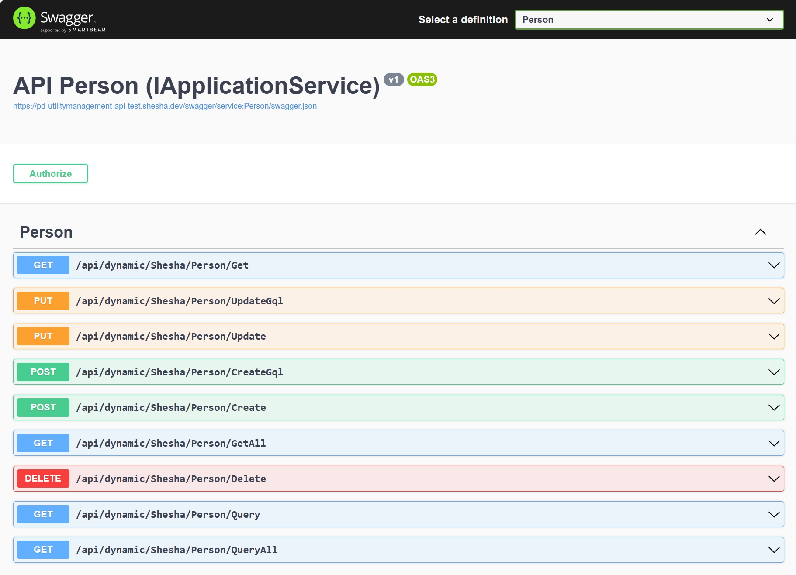
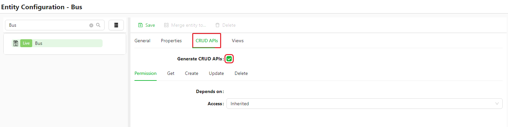
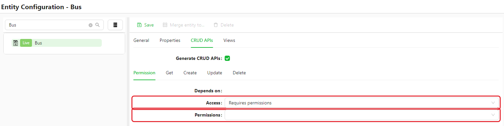

# Dynamic CRUD APIs

Shesha provides a feature to auto-generate a set of CRUD (Create, Read, Update, Delete) APIs for any entity. These APIs can be utilized to carry out CRUD operations on that entity. Furthermore, you can link these APIs from the form configurator, enabling you to swiftly construct a user interface for managing these entities.

## Generated APIs

As an example, the image below shows the list of generated APIs for the `Person` entity:



:::warning Deprecated end-points
Please note as per [GitHub Issue 838](https://github.com/shesha-io/shesha-framework/issues/838) the following duplicative and deprecated end-points will be removed in the future: UpdateGql, CreateGql, Query, GetAll
:::

### Get

Returns a single entity by its Id
Return single entity by it's Id. Here [entity] - is a camel cased name of the entity class.

### QueryAll

Returns a list of entities using GraphQL.
| Argument | Description|
|--|--|
| properties | Specifies which properties to return. The format is the same as for GQL queries e.g. `id firstName lastName`. Employing the GQL format allows you to also specify nested properties for referenced entities. For example, if you wish to also return `id firstName lastName primaryOrganisation { id name }` If left blank, all top level properties for the entity will be returned. |
| filter | Filter in [JsonLogic](https://jsonlogic.com/) format |
| quickSearch | Quick search string. This argument will probe different properties of the entity at once. It's important to note that it will only examine text, reference list, and entity reference properties. For entity reference properties, the argument will look into the display name property of any entities referred to. |
| specifications | List [specifications](/docs/fundamentals/specifications) to apply. |
| sorting | Comma delimited properties to sort. The format is the same as for SQL queries e.g. `firstName, lastName desc` |
| skipCount | Number of entities to skip before returning the results. |
| maxResultCount | Maximum number of entities to return in the result set. |

### Create

Creates a new entity.

### Update

Updates an existing entity.

### Delete

Deletes an existing entity.

---

## Controlling and Securing CRUD APIs in Code

Every entity's CRUD APIs are controlled in one place: the `[Entity]` attribute on the entity class. It lets you state two things explicitly:

- **Which** CRUD actions the entity exposes (Create, Read, Update, Delete).
- **Who** may call them (anyone, any logged-in user, or only users with specific permissions).

If you need different rules for different actions (for example, anyone logged in can read, but only managers can delete), you add one or more `[EntityAuthorize]` attributes on top.

:::info Changed in 0.43
The `GenerateApplicationService` parameter of `[Entity]` has been **removed**. Its job is now done by the `CrudActions`, `CrudActionsAccess`, `CrudActionsPermissions` and `IsConfigurable` parameters of `[Entity]`, plus the new `[EntityAuthorize]` attribute. The `[CrudDisableActions]` and `[CrudAccess]` attributes shown in earlier versions of this page are **not** available. See [Migrating from the Old Attributes](#migrating-from-the-old-attributes) below.
:::

### Step 1: Choose which CRUD actions to expose

Set the `CrudActions` parameter of `[Entity]`. `CrudActions` is a flags enum (`Shesha.Domain.Enums`), so you can combine values with `|`.

| Value | Exposes |
|---|---|
| `CrudActions.All` | Create, Read, Update and Delete |
| `CrudActions.None` | Nothing |
| `CrudActions.Create` | Create only |
| `CrudActions.Read` | Get, GetAll and QueryAll |
| `CrudActions.Update` | Update only |
| `CrudActions.Delete` | Delete only |

**Example - a read-only entity:**

```csharp
using Shesha.Domain.Attributes;
using Shesha.Domain.Enums;

// highlight-start
[Entity(CrudActions = CrudActions.Read)]
// highlight-end
public class ExchangeRate : FullAuditedEntity<Guid>
{
    public virtual string Currency { get; set; }
    public virtual decimal Rate { get; set; }
}
```

**Example - expose Create and Read, but not Update or Delete:**

```csharp
[Entity(CrudActions = CrudActions.Create | CrudActions.Read)]
public class AuditNote : FullAuditedEntity<Guid>
{
    public virtual string Note { get; set; }
}
```

:::warning Set `CrudActions` whenever you use `[Entity]`
How the defaults work depends on whether the entity has an `[Entity]` attribute at all:

- **No `[Entity]` attribute:** all CRUD actions are exposed (`CrudActions.All`), access is `Inherited`, and the settings can be changed through configuration.
- **`[Entity]` attribute without `CrudActions`:** `CrudActions` defaults to `None`, so **no CRUD actions are exposed**.

So if you add `[Entity]` to an entity (for example, only to set `FriendlyName`), also set `CrudActions` if you want its CRUD APIs to remain available.
:::

### Step 2: Choose who can call them

Set the `CrudActionsAccess` parameter to one of the `CrudActionsAccess` values (`Shesha.Domain.Enums`). If you choose `RequiresPermissions`, list the permissions in `CrudActionsPermissions`.

| Value | Who can call the exposed actions |
|---|---|
| `AnyAuthenticated` | Any logged-in user. **This is the default** when you use `[Entity]`. |
| `RequiresPermissions` | Only users who hold **at least one** of the permissions in `CrudActionsPermissions`. |
| `AllowAnonymous` | Anyone, including users who are not logged in. |
| `Inherited` | Falls back to the **Default Endpoint Access** system setting (see [Endpoint Permissions](/docs/fundamentals/security/endpoint-permissions#default-endpoint-access)). |

**Example - all CRUD actions require the `Order-Manage` permission:**

```csharp
[Entity(
    CrudActions = CrudActions.All,
    CrudActionsAccess = CrudActionsAccess.RequiresPermissions,
    CrudActionsPermissions = ["Order-Manage"]
)]
public class Order : FullAuditedEntity<Guid>
{
    public virtual string OrderNo { get; set; }
}
```

:::warning `CrudActionsPermissions` needs `RequiresPermissions`
`CrudActionsPermissions` is only checked when `CrudActionsAccess = CrudActionsAccess.RequiresPermissions`. If you set permissions but leave `CrudActionsAccess` at its default (`AnyAuthenticated`), the permissions are ignored and any logged-in user can call the APIs.
:::

:::tip Use permission name constants
Instead of typing permission names as strings, keep them as constants in one class (for example `MyAppPermissionNames.Order_Manage`) and reference those. This is the pattern the framework itself uses with `Shesha.Authorization.PermissionNames`. See [Standard Roles and Permissions](/docs/fundamentals/security/standard-roles-and-permissions).
:::

### Step 3: Decide whether configurators can change it

Set `IsConfigurable` to state whether the settings in code are a **default** or **final**.

| `IsConfigurable` | Meaning |
|---|---|
| `true` (default) | The code sets the default. A configurator can change the exposed actions and their access rules on the **CRUD APIs** tab of the entity configurator. |
| `false` | The code is final. Configuration cannot override it, and the **CRUD APIs** tab shows the message *"Configuration of CRUD APIs are disabled in the code"* instead of the editable settings. |

Use `IsConfigurable = false` for sensitive entities where an accidental configuration change could open up data. For example, the framework uses it on `ShaRole`, `Notification`, `FormConfiguration` and `ShaUserLoginAttempt`.

```csharp
[Entity(
    CrudActions = CrudActions.Read,
    CrudActionsAccess = CrudActionsAccess.RequiresPermissions,
    CrudActionsPermissions = ["Application-Administer"],
    // highlight-start
    IsConfigurable = false
    // highlight-end
)]
public class PaymentLog : FullAuditedEntity<Guid>
{
    public virtual decimal Amount { get; set; }
}
```

:::note
If an action is excluded by `CrudActions` **and** `IsConfigurable = false`, calling that endpoint returns a *Not found* error. If `CrudActions` is `None` and `IsConfigurable = false`, Shesha does not build a controller for the entity at all, so it does not appear in Swagger.
:::

### Step 4 (optional): Different rules per action with `[EntityAuthorize]`

When one access rule for all actions isn't enough, add `[EntityAuthorize]` attributes. Each one overrides the access rule of **one** CRUD action. You can stack as many as you need, but use only one per action.

`[EntityAuthorize]` has two constructors:

| Constructor | Use it to |
|---|---|
| `[EntityAuthorize(CrudAction action, CrudActionsAccess access)]` | Set the action to `AllowAnonymous`, `AnyAuthenticated` or `Inherited`. |
| `[EntityAuthorize(CrudAction action, string[] permissions)]` | Require at least one of the listed permissions for the action. |

Note that `[EntityAuthorize]` takes a single `CrudAction` (singular: `Create`, `Read`, `Update` or `Delete`), not the `CrudActions` flags.

**Example - one permission per action.** This is how the framework secures the `Person` entity:

```csharp
[Entity(CrudActions = CrudActions.All, CrudActionsAccess = CrudActionsAccess.RequiresPermissions)]
// highlight-start
[EntityAuthorize(CrudAction.Create, [PermissionNames.Person_Create])]
[EntityAuthorize(CrudAction.Read,   [PermissionNames.Person_View])]
[EntityAuthorize(CrudAction.Update, [PermissionNames.Person_Update])]
[EntityAuthorize(CrudAction.Delete, [PermissionNames.Person_Delete])]
// highlight-end
public class Person : FullPowerEntity
{
    ...
}
```

**Example - anyone can read, only configurators can change.** This is how the framework secures `ReferenceList`:

```csharp
[Entity(
    CrudActions = CrudActions.All,
    IsConfigurable = false,
    CrudActionsAccess = CrudActionsAccess.AllowAnonymous   // default for all actions
)]
// highlight-start
[EntityAuthorize(CrudAction.Create, [PermissionNames.Application_Configure, PermissionNames.Application_Administer])]
[EntityAuthorize(CrudAction.Update, [PermissionNames.Application_Configure, PermissionNames.Application_Administer])]
[EntityAuthorize(CrudAction.Delete, [PermissionNames.Application_Configure, PermissionNames.Application_Administer])]
// highlight-end
public class ReferenceList : ConfigurationItemBase
{
    ...
}
```

Here, `Read` has no `[EntityAuthorize]`, so it uses the `[Entity]` default (`AllowAnonymous`). The other three actions need `Application-Configure` or `Application-Administer`.

**Example - a broader permission for most actions, and an extra one for reading:**

```csharp
[Entity(
    CrudActions = CrudActions.All,
    CrudActionsAccess = CrudActionsAccess.RequiresPermissions,
    CrudActionsPermissions = ["Order-Manage"]
)]
[EntityAuthorize(CrudAction.Read, ["Order-View", "Order-Manage"])]
public class Order : FullAuditedEntity<Guid>
{
    ...
}
```

Users with `Order-View` can only read orders. Users with `Order-Manage` can do everything.

:::info `[EntityAuthorize]` does not expose an action
`[EntityAuthorize]` only sets *who* can call an action. The action must also be included in `CrudActions` on `[Entity]`, otherwise it is still not exposed.
:::

### `[AllowAnonymous]` is not supported on entities

Don't put the ASP.NET Core `[AllowAnonymous]` attribute on an entity class. Shesha ignores it there. To make an entity's CRUD APIs public, say so explicitly:

```csharp
// Correct: make all exposed actions public
[Entity(CrudActions = CrudActions.Read, CrudActionsAccess = CrudActionsAccess.AllowAnonymous)]
public class PublicHoliday : FullAuditedEntity<Guid> { ... }

// Correct: make only Read public
[Entity(CrudActions = CrudActions.All, CrudActionsAccess = CrudActionsAccess.RequiresPermissions, CrudActionsPermissions = ["Holiday-Manage"])]
[EntityAuthorize(CrudAction.Read, CrudActionsAccess.AllowAnonymous)]
public class PublicHoliday : FullAuditedEntity<Guid> { ... }
```

### Immutable entities

If an entity has the `[ImMutable]` attribute, Shesha removes the Create, Update and Delete actions from its CRUD APIs, whatever `CrudActions` says. Only Read remains.

---

## Controlling and Securing CRUD APIs through Configuration

If the entity is configurable (no `[Entity]` attribute, or `IsConfigurable = true`), a configurator can change its CRUD APIs without a code change. This is useful if you don't have access to the entity's source code, or want the flexibility to adjust access after deployment.

1. In your running Shesha application, go to **Administration > Entity Configuration** on the main menu.
2. Select the entity.
3. Open the **CRUD APIs** tab.
4. To stop generating the CRUD APIs, clear the **Generate CRUD APIs** checkbox:

   

5. To secure them, set the access level and required permissions for each CRUD API:

   

If the entity has `IsConfigurable = false` in code, the tab only shows *"Configuration of CRUD APIs are disabled in the code"*. Change the attribute in code instead.

---

## Migrating from the Old Attributes

If you're upgrading code written for an earlier 0.43 release, replace the `GenerateApplicationService` parameter as follows. The code will not compile until you do.

| Before | After |
|---|---|
| `[Entity(GenerateApplicationService = GenerateApplicationServiceState.UseConfiguration)]` | `[Entity(CrudActions = CrudActions.All)]` |
| `[Entity(GenerateApplicationService = GenerateApplicationServiceState.AlwaysGenerateApplicationService)]` | `[Entity(CrudActions = CrudActions.All, IsConfigurable = false)]` |
| `[Entity(GenerateApplicationService = GenerateApplicationServiceState.DisableGenerateApplicationService)]` | `[Entity(CrudActions = CrudActions.None, IsConfigurable = false)]` |

Remember that `[Entity]` now defaults to `CrudActionsAccess.AnyAuthenticated`. Set `CrudActionsAccess` explicitly if the entity needs a different access level.

If you followed an earlier version of this page that described the `[CrudDisableActions]` and `[CrudAccess]` attributes, use these equivalents:

| Before | After |
|---|---|
| `[CrudDisableActions(CrudActions.Update \| CrudActions.Delete)]` | `[Entity(CrudActions = CrudActions.Create \| CrudActions.Read)]` |
| `[CrudAccess(CrudActions.Read, RefListPermissionedAccess.AllowAnonymous)]` | `[EntityAuthorize(CrudAction.Read, CrudActionsAccess.AllowAnonymous)]` |
| `[CrudAccess(CrudActions.Update, RefListPermissionedAccess.RequiresPermissions, ["Order-Manage"])]` | `[EntityAuthorize(CrudAction.Update, ["Order-Manage"])]` |
| `[CrudAccess(CrudActions.Delete, RefListPermissionedAccess.Disable)]` | Leave `Delete` out of `CrudActions` on `[Entity]` |
| `[AllowAnonymous]` on the entity class | `[Entity(CrudActionsAccess = CrudActionsAccess.AllowAnonymous, ...)]` |

**Full example - no Delete, Update needs a permission:**

```csharp
[Entity(
    CrudActions = CrudActions.Create | CrudActions.Read | CrudActions.Update,
    CrudActionsAccess = CrudActionsAccess.AnyAuthenticated
)]
[EntityAuthorize(CrudAction.Update, ["Order-Manage"])]
public class Order : FullAuditedEntity<Guid> { ... }
```

:::warning Remember the `[Entity]` default
When you add `[Entity]` while migrating, always set `CrudActions`. Leaving it out means `CrudActions.None`, which turns off the entity's CRUD APIs.
:::

---

## Customizing behavior of CRUD APIs

There is a number of ways to customize the behavior of the generated CRUD APIs.

### Enforcing validation and business logic on Create and Update end-points

To enforce validation and other business logic on Create and Update operations use [Fluent Validation](/docs/fundamentals/validation#applying-validation-on-auto-generated-crud-apis).

### Customizing Querying behavior on QueryAll end-point

To 'inject' custom querying logic into the generated QueryAll end-point you implement [Specifications](/docs/fundamentals/specifications).

[//]: # "### Customizing Quick Search behavior"
[//]: # "To customize the Quick Search behavior you can implement ??? need to describe way to utilise a custom IQuickSearcher."

# See Also

- [Custom APIs](/docs/back-end-basics/custom-apis)
- [Validation](/docs/fundamentals/validation)
- [Specifications](/docs/fundamentals/specifications)
