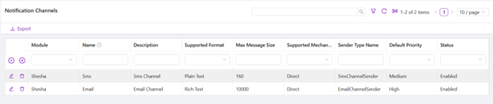
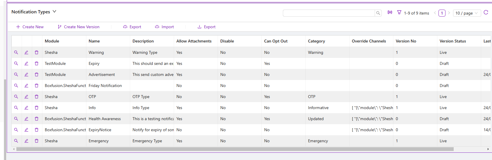
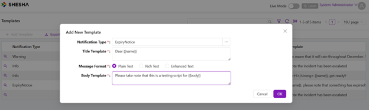
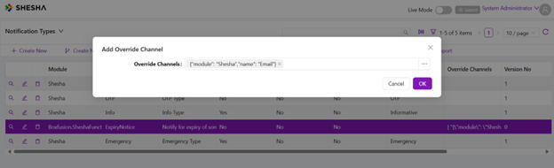
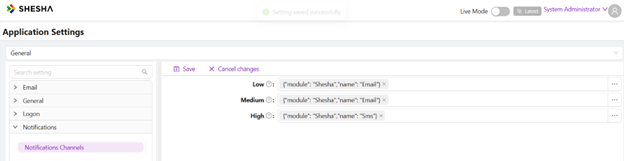

# Notifications

Shesha provides a built-in notification framework for sending messages through multiple channels such as Email, SMS, and Push notifications. The framework is designed to be:

- **Multi-channel.** SMS and Email are included out of the box, with a plugin architecture that makes it straightforward to add custom channels such as Slack, Teams, or WhatsApp.
- **Reliable.** Notifications are queued for background processing with automatic retries (up to three attempts) on failure.
- **Auditable.** Every notification sent is recorded with full details, including status, timestamps, and error messages.
- **Configurable.** An admin UI lets you manage notification types, templates, and channel settings without code changes.
- **Flexible.** It supports both asynchronous (queued) and synchronous (immediate) delivery for time-sensitive messages such as OTPs.

---

## Key concepts

### Channels

A channel represents a delivery mechanism such as Email or SMS. Each channel is defined by a `NotificationChannelConfig` entity with the following key properties.

| Property | Description |
|---|---|
| Name | Display name (for example "Email" or "SMS"). |
| SupportedFormat | Message format the channel accepts: `PlainText`, `RichText`, or `EnhancedText`. |
| SupportedMechanism | `Direct`, `BulkSend`, or `Broadcast`. |
| MaxMessageSize | Maximum message length (useful for SMS). |
| SupportsAttachment | Whether the channel supports file attachments. |
| Status | `Enabled`, `Disabled`, or `Suppressed`. |

Shesha ships with two pre-configured channels: SMS and Email.



#### Registering a channel

Channels are registered in `Startup.cs` via dependency injection:

```csharp
services.AddTransient<INotificationChannelSender, EmailChannelSender>();
services.AddTransient<INotificationChannelSender, SmsChannelSender>();
```

To add a custom channel, implement the `INotificationChannelSender` interface and register it the same way. See [Custom Notification Channels](custom-notification-channels.md) for a full guide.

___

### Notification types and templates

A notification type (`NotificationTypeConfig`) defines a category of notification, such as "Welcome Email" or "Password Reset". Each type has one or more templates that define the actual message content for different channels.

The notification type properties are:

| Property | Description |
|---|---|
| Name | Unique name identifying the notification type. |
| Description | Human-readable description. |
| Disable | Globally disable this notification type. |
| CanOptOut | Whether users can opt out of receiving this notification. |
| IsTimeSensitive | If `true`, sends immediately (synchronously) instead of queuing. |
| AllowAttachments | Whether attachments can be included. |
| DefaultPriority | `Low`, `Medium`, or `High`. Decides which default channels are used when nothing else applies. If it is empty, `Medium` is used. |
| OverrideChannels | Channels this type must always use instead of the priority defaults. See [Override channels](#override-channels). |
| Category | Optional grouping label for analysis. |

The template properties are:

| Property | Description |
|---|---|
| TitleTemplate | Subject or title using Mustache syntax (for example `Dear {{FullName}}`). |
| BodyTemplate | Message body using Mustache syntax. |
| MessageFormat | `PlainText` or `RichText` (HTML). Must match the channel's supported format. |





:::tip Admin UI
Notification types and templates can be managed through the admin UI. Navigate to the Notification Types configuration section to create, edit, or disable notification types and their associated templates.
:::

:::note Template-channel matching
Each template's `MessageFormat` must be compatible with the channel it is used on. For example, an Email channel typically supports `RichText` (HTML), while an SMS channel supports `PlainText`. If a notification type can be sent through both Email and SMS, create separate templates, one with `RichText` for Email and one with `PlainText` for SMS.
:::

___

### Channel selection logic

When a notification is sent, the framework decides which channel or channels to use through this priority hierarchy:

1. **Explicit channel.** If a channel is passed directly in the `SendNotificationAsync` call, only that channel is used.
2. **User preferences.** If the recipient has set a `UserNotificationPreference` for this notification type, that channel is used.
3. **Override channels.** If the notification type has `OverrideChannels` configured, only those channels are used, and the priority defaults are skipped. See [Override channels](#override-channels).
   
4. **System defaults.** Otherwise, the default channels for the type's `DefaultPriority` (High, Medium, or Low) are taken from the notification settings. If the type has no `DefaultPriority`, `Medium` is used.
   

#### Override channels

Use override channels when a notification must always go a specific way, whatever its priority. For example, a one-time PIN (OTP) should always go by SMS.

To set them, open the notification type in the admin UI and pick one or more channels in the **Override Channels** field. It is a multi-select list of the configured notification channels. The choices are saved on the type as a list of channel identifiers (module and name):

```json
[
  { "module": "Shesha", "name": "Email" },
  { "module": "Shesha", "name": "Sms" }
]
```

Keep these rules in mind:

- Each item must match an existing channel's **name and module**. For example, the built-in SMS channel is named `Sms` in the `Shesha` module.
- Only the **Live** version of a channel is used.
- A recipient's own preference (step 2) still wins over the override channels.
- Override channels replace the priority defaults completely. If **none** of them can be found, the notification is **not sent**, and there is no error and no fallback to the priority defaults.

___

### Application-level settings

Global notification settings are configured under the Notifications settings category (`Shesha.Notification.Settings`). The settings editor form (`notification-settings`) lets you configure:

| Setting | Description |
|---|---|
| Low priority channels | Default channel or channels for low-priority notifications. |
| Medium priority channels | Default channel or channels for medium-priority notifications. |
| High priority channels | Default channel or channels for high-priority notifications. |
| Test channel | Channel used for testing notifications. |

Each channel type also has its own settings:

- **Email settings:** SMTP configuration, an enable/disable flag, and a `RedirectAllMessagesTo` option for routing all emails to a test address during development.
- **SMS settings:** Gateway configuration, an enable/disable flag, and a similar `RedirectAllMessagesTo` option for testing.

___

### INotificationSender service

`INotificationSender` is the primary service for sending notifications from your application code. It provides two overloads of `SendNotificationAsync`.

The first is person-based and is the simplest. The most common usage passes `Person` entities for the sender and recipient.

```csharp
Task SendNotificationAsync<TData>(
    NotificationTypeConfig type,        // The notification type to send
    Person? sender,                     // Sender (nullable)
    Person receiver,                    // Recipient
    TData data,                         // Template data (extends NotificationData)
    List<NotificationAttachmentDto>? attachments = null,
    string? cc = null,                  // CC addresses (semicolon-delimited)
    GenericEntityReference? triggeringEntity = null,
    NotificationChannelConfig? channel = null,  // Force a specific channel
    string? category = null
) where TData : NotificationData;
```

:::note No priority parameter
`SendNotificationAsync` has no priority parameter. The priority comes from the notification type's `DefaultPriority`, or `Medium` if it is not set.
:::

The second is participant-based and is for advanced scenarios. When you need to send to a raw address (such as an email or phone number not linked to a `Person` entity), use `IMessageSender` and `IMessageReceiver` participants.

```csharp
Task SendNotificationAsync<TData>(
    NotificationTypeConfig type,
    IMessageSender? sender,
    IMessageReceiver receiver,
    TData data,
    List<NotificationAttachmentDto>? attachments = null,
    string? cc = null,
    GenericEntityReference? triggeringEntity = null,
    NotificationChannelConfig? channel = null,
    string? category = null
) where TData : NotificationData;
```

There are two message participant types:

- `PersonMessageParticipant` wraps a `Person` entity. The channel extracts the address automatically (for example `EmailAddress1` for email or `MobileNumber1` for SMS).
- `RawAddressMessageParticipant` wraps a raw address string (for example `"user@example.com"` or `"+27821234567"`). This is useful when you do not have a `Person` record.

**Example - Send to a raw email address:**

```csharp
var receiver = new RawAddressMessageParticipant("user@example.com");
await _notificationSender.SendNotificationAsync(type, null, receiver, data);
```

---

## Implementation guide

### Project structure

Place notification-related classes in a `Notifications` folder within your Application project:

```
MyProject.Application/
└── Notifications/
    ├── IOrderNotificationSender.cs      // Interface
    ├── OrderNotificationSender.cs        // Implementation
    └── OrderNotificationModel.cs         // Template data model
```

### Step 1: Define the template data model

Create a class extending `NotificationData` with properties that map to your template placeholders:

```csharp
using Abp.Notifications;

namespace MyProject.Notifications
{
    public class OrderNotificationModel : NotificationData
    {
        public string CustomerName { get; set; }
        public string OrderNumber { get; set; }
        public string OrderDate { get; set; }
    }
}
```

The property names must match the Mustache placeholders in your templates (for example `{{CustomerName}}`).

:::tip Simple alternative
For simple cases you can skip creating a model class and use `NotificationData` directly as a dictionary:

```csharp
var data = new NotificationData();
data["CustomerName"] = "John Smith";
data["OrderNumber"] = "ORD-001";
```
:::

### Step 2: Create notification types and templates

Notification types and templates are stored in the database. You have two options.

The first is the admin UI. Create them directly through the admin UI, which is recommended for non-developers or when you want to iterate on template text without redeploying.

The second is a database migration. Use FluentMigrator with Shesha's helper methods to seed notification types and templates as part of your deployment.

**Example - Seed a notification type with email and SMS templates:**

```csharp
using FluentMigrator;
using Shesha.FluentMigrator;

[Migration(20250226120000)]
public class M20250226120000 : Migration
{
    public override void Up()
    {
        // Create a notification type with an Email template
        this.Shesha().NotificationCreate("MyModule", "Order Confirmed")
            .SetDescription("Sent when a customer's order is confirmed.")
            .AddEmailTemplate(
                "A1B2C3D4-E5F6-7890-ABCD-EF1234567890".ToGuid(),
                "Order Confirmation Email",                          // Template name
                "Your order {{OrderNumber}} has been confirmed",     // Subject template
                @"<p>Dear {{CustomerName}},</p>
                  <p>Your order <strong>{{OrderNumber}}</strong> placed on {{OrderDate}}
                  has been confirmed.</p>");

        // Add an SMS template for the same notification type
        this.Shesha().NotificationUpdate("MyModule", "Order Confirmed")
            .AddSmsTemplate(
                "B2C3D4E5-F6A7-8901-BCDE-F12345678901".ToGuid(),
                "Order Confirmation SMS",
                "Hi {{CustomerName}}, your order {{OrderNumber}} is confirmed.");
    }

    public override void Down()
    {
        throw new NotImplementedException();
    }
}
```

The available migration helper methods are:

| Method | Description |
|---|---|
| `NotificationCreate(module, name)` | Create a new notification type. |
| `NotificationUpdate(module, name)` | Update an existing notification type. |
| `.SetDescription(text)` | Set the type's description. |
| `.AddEmailTemplate(id, name, subject, body)` | Add an email template (RichText format). |
| `.AddSmsTemplate(id, name, body)` | Add an SMS template (PlainText format). |
| `.AddPushTemplate(id, name, subject, body)` | Add a push notification template. |
| `NotificationTemplateUpdate(id)` | Update an existing template. |
| `NotificationTemplateDelete(id)` | Delete a template. |

Template IDs are GUIDs that must be unique. Generate them with any GUID generator.

### Step 3: Implement the notification sender

Create an interface and implementation class that encapsulates the notification logic for your domain.

The interface:

```csharp
namespace MyProject.Notifications
{
    public interface IOrderNotificationSender
    {
        Task NotifyOrderConfirmedAsync(Guid orderId);
    }
}
```

The implementation:

```csharp
using Abp.Dependency;
using Abp.Domain.Repositories;
using Shesha.Domain;
using Shesha.Notifications;

namespace MyProject.Notifications
{
    public class OrderNotificationSender : IOrderNotificationSender, ITransientDependency
    {
        private readonly INotificationSender _notificationSender;
        private readonly IRepository<NotificationTypeConfig, Guid> _notificationTypeRepo;
        private readonly IRepository<Person, Guid> _personRepo;
        private readonly IRepository<Order, Guid> _orderRepo;

        public OrderNotificationSender(
            INotificationSender notificationSender,
            IRepository<NotificationTypeConfig, Guid> notificationTypeRepo,
            IRepository<Person, Guid> personRepo,
            IRepository<Order, Guid> orderRepo)
        {
            _notificationSender = notificationSender;
            _notificationTypeRepo = notificationTypeRepo;
            _personRepo = personRepo;
            _orderRepo = orderRepo;
        }

        public async Task NotifyOrderConfirmedAsync(Guid orderId)
        {
            var order = await _orderRepo.GetAsync(orderId);
            var notificationType = await _notificationTypeRepo.FirstOrDefaultAsync(
                x => x.Name == "Order Confirmed");

            if (notificationType == null)
                return;

            var data = new OrderNotificationModel
            {
                CustomerName = order.Customer.FullName,
                OrderNumber = order.OrderNumber,
                OrderDate = order.OrderDate.ToString("dd MMM yyyy")
            };

            await _notificationSender.SendNotificationAsync(
                notificationType,
                sender: null,
                receiver: order.Customer,
                data: data);
        }
    }
}
```

### Step 4: Call the notification sender

Inject your notification sender and call it from your application service or workflow:

```csharp
public class OrderAppService : SheshaAppServiceBase
{
    private readonly IOrderNotificationSender _orderNotificationSender;

    public OrderAppService(IOrderNotificationSender orderNotificationSender)
    {
        _orderNotificationSender = orderNotificationSender;
    }

    public async Task ConfirmOrderAsync(Guid orderId)
    {
        // ... order confirmation logic ...

        await _orderNotificationSender.NotifyOrderConfirmedAsync(orderId);
    }
}
```

---

## Common scenarios

### Sending to multiple recipients

To notify several people, loop through the recipients:

```csharp
foreach (var person in recipients)
{
    await _notificationSender.SendNotificationAsync(
        notificationType, sender: null, receiver: person, data);
}
```

### Forcing a specific channel

Pass a `NotificationChannelConfig` to override the default channel selection:

```csharp
var emailChannel = await _channelRepo.FirstOrDefaultAsync(x => x.Name == "Email");

await _notificationSender.SendNotificationAsync(
    notificationType, sender: null, receiver: person, data,
    channel: emailChannel);
```

### Including attachments

Pass a list of `NotificationAttachmentDto` referencing stored files:

```csharp
var attachments = new List<NotificationAttachmentDto>
{
    new NotificationAttachmentDto
    {
        FileName = "invoice.pdf",
        StoredFileId = storedFile.Id
    }
};

await _notificationSender.SendNotificationAsync(
    notificationType, sender: null, receiver: person, data,
    attachments: attachments);
```

:::note
Attachments are only sent if the notification type has `AllowAttachments` set to `true` and the channel supports attachments (`SupportsAttachment = true`). If either is `false`, the attachments are dropped **without an error**, and the message is sent without them.
:::

### Linking a triggering entity

Use `GenericEntityReference` to link the notification to the entity that triggered it, which is useful for audit trails:

```csharp
await _notificationSender.SendNotificationAsync(
    notificationType, sender: null, receiver: person, data,
    triggeringEntity: new GenericEntityReference(order));
```

---

## Asynchronous vs synchronous delivery

By default, notifications are queued for background processing. This suits most cases, such as confirmations and reminders.

For time-sensitive messages such as OTPs and security alerts, set `IsTimeSensitive = true` on the notification type. This causes the notification to be sent immediately in the current thread, bypassing the background queue.

---

## Retry behaviour

Failed notifications are retried automatically up to three times, with delays of 10, 20, and 20 seconds respectively. The `NotificationMessage` entity tracks:

- `RetryCount` - the number of attempts made.
- `Status` - `Preparing`, `Sent`, `WaitToRetry`, or `Failed`.
- `ErrorMessage` - details of the last failure.

---

## Troubleshooting

Shesha records every send, so start with the `Notification` and `NotificationMessage` records:

| What you see | Likely cause | What to check |
|---|---|---|
| Nothing is recorded for one recipient | The recipient opted out | `CanOptOut` on the notification type, and the recipient's notification preferences. |
| A `Notification` record, but no `NotificationMessage` | No channel was selected | That the override channels match real channels (name and module), or that the notification settings have a channel for the type's `DefaultPriority`. |
| Error: "There is no ... template found for the ... channel" | The type has no template in that channel's format | Add a template whose `MessageFormat` matches the channel's `SupportedFormat`. |
| A `NotificationMessage` with status `Failed` or `WaitToRetry` | The channel could not deliver | The message's `ErrorMessage`, and the channel's own settings (SMTP or SMS gateway). |
| Status `Sent`, but the email is not in the inbox | Emails are redirected | Email settings → `RedirectAllMessagesTo`, which sends every email to one test address. |
| The email arrives without its attachment | The attachment was dropped | `AllowAttachments` on the type and `SupportsAttachment` on the channel. |

---

## Custom notification channels

The built-in Email and SMS channels cover most use cases. If you need to deliver notifications through a different medium such as Slack, Microsoft Teams, or WhatsApp, Shesha's plugin architecture makes it straightforward to add custom channels. See [Custom Notification Channels](custom-notification-channels.md) for a step-by-step guide.
