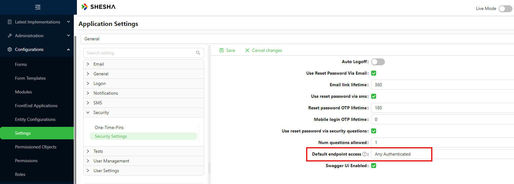
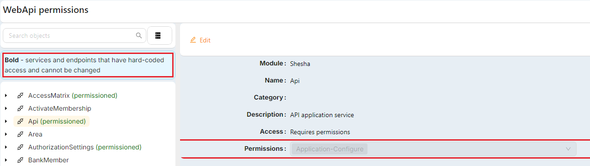

# Endpoint Permissions

Every API endpoint in a Shesha application has a permission level that controls who can call it. By default, Shesha scans your application on startup and registers all endpoints in a central store called Permissioned Objects. From there, you can control access through code attributes, a system-wide default setting, or the Permissioned Objects configuration UI. Understanding how these three mechanisms interact - and which one takes priority - is essential for building secure APIs.

---

## Access Levels

Every endpoint is assigned one of five access levels. These are the same options you see in the Permissioned Objects UI and in code via the `RefListPermissionedAccess` enum.

| Level | What it means |
|---|---|
| `Allow Anonymous` | Anyone can call the endpoint, whether or not they are logged in. |
| `Any Authenticated` | Any logged-in user can call the endpoint, regardless of their permissions. |
| `Requires Permissions` | Only users who hold at least one of the specified permissions can call the endpoint. |
| `Inherited` | The endpoint defers to its parent service. If the parent is also `Inherited`, it falls back to the `DefaultEndpointAccess` system setting. |
| `Disable` | The endpoint is turned off entirely. Callers receive an error response. |

---

## Controlling Access in Code

Use the `[SheshaAuthorize]` attribute (`Shesha.Authorization`) to set an endpoint's access level in code. You can put it on an application service class (applies to all its methods) or on a single method (overrides the class).

```csharp
[SheshaAuthorize(RefListPermissionedAccess access, params string[] permissions, IsConfigurable = true | false)]
```

| Parameter | Description |
|---|---|
| `access` | One of the `RefListPermissionedAccess` levels above, e.g. `RequiresPermissions` or `AnyAuthenticated`. If you use `RequiresPermissions` but list no permissions, Shesha treats it as `AnyAuthenticated`. |
| `permissions` | The permission names to check when `access` is `RequiresPermissions`. The user needs **at least one** of them. |
| `IsConfigurable` | Whether a configurator may override this setting in the **Permissioned Objects** UI. Defaults to `true`. |

Each endpoint falls into one of three cases.

### Case 1: Fixed (`IsConfigurable = false`)

Set `IsConfigurable = false` when the access rule must never be changed through configuration. Shesha marks the endpoint as `Hardcoded`. The Permissioned Objects UI shows the value as read-only, and the code value is applied again on every startup.

**Example - only users with the `Invoice-Approve` permission can call this service:**

```csharp
using Shesha.Authorization;
using Shesha.Domain.Enums;

// highlight-start
[SheshaAuthorize(RefListPermissionedAccess.RequiresPermissions, "Invoice-Approve", IsConfigurable = false)]
// highlight-end
public class InvoiceApprovalAppService : SheshaAppServiceBase
{
    [HttpPost]
    public async Task ApproveAsync(Guid invoiceId)
    {
        // ...
    }
}
```

Use this for security-critical endpoints. The framework's own application services use it, for example:

```csharp
[SheshaAuthorize(RefListPermissionedAccess.RequiresPermissions, PermissionNames.Application_Configure, IsConfigurable = false)]
public class ModelConfigurationsAppService : SheshaAppServiceBase { ... }
```

### Case 2: Configurable (`IsConfigurable = true`, the default)

Leave `IsConfigurable` out (or set it to `true`) when you want to ship a sensible default from code, but still let an administrator adjust it later without a deployment.

```csharp
// The default is RequiresPermissions + WorkOrder-View, but a configurator can change it.
[SheshaAuthorize(RefListPermissionedAccess.RequiresPermissions, "WorkOrder-View")]
[HttpGet, Route("{id}")]
public async Task<WorkOrderDto> GetWorkOrder(Guid id)
{
    // ...
}
```

The code value is written to the database the first time the endpoint is registered. After that, the database is the source of truth. See [How Updates Work](#how-updates-work).

### Case 3: Anonymous with `[AllowAnonymous]`

The ASP.NET Core `[AllowAnonymous]` attribute (and ABP's `[AbpAllowAnonymous]`) makes an endpoint public. It **takes precedence** over `[SheshaAuthorize]` and is **not configurable**: the endpoint is marked `Hardcoded` and shown as read-only in the UI.

```csharp
// Always public. Can never be locked down through the UI.
// highlight-start
[AllowAnonymous]
// highlight-end
[HttpGet, Route("public-status")]
public async Task<StatusDto> GetPublicStatus()
{
    // ...
}
```

At runtime, `[AllowAnonymous]` and `[AbpAllowAnonymous]` skip authorization entirely. No Permissioned Objects lookup happens for these endpoints.

If you want an endpoint to be **anonymous by default, but configurable** (for example, so an administrator can lock it down later), use `[SheshaAuthorize]` instead:

```csharp
[SheshaAuthorize(RefListPermissionedAccess.AllowAnonymous, IsConfigurable = true)]
[HttpGet, Route("opening-hours")]
public async Task<OpeningHoursDto> GetOpeningHours()
{
    // ...
}
```

### Summary of the three cases

| You want the endpoint to be... | Use |
|---|---|
| Secured, and never changed by configuration | `[SheshaAuthorize(access, permissions..., IsConfigurable = false)]` |
| Secured by default, but adjustable by configuration | `[SheshaAuthorize(access, permissions...)]` |
| Always public | `[AllowAnonymous]` |
| Public by default, but adjustable by configuration | `[SheshaAuthorize(RefListPermissionedAccess.AllowAnonymous, IsConfigurable = true)]` |

:::warning `[AbpAuthorize]` and `[Authorize]` are no longer used
Shesha no longer reads `[AbpAuthorize]`, `[AbpMvcAuthorize]` or the ASP.NET Core `[Authorize]` attribute when it registers permissioned objects. The framework's application services have been converted to `[SheshaAuthorize(..., IsConfigurable = false)]` so the Permissioned Objects UI shows what is actually enforced. Do the same in your own application services:

```csharp
// Before
[AbpAuthorize("Invoice-Approve")]
public class InvoiceApprovalAppService : SheshaAppServiceBase { ... }

// After
[SheshaAuthorize(RefListPermissionedAccess.RequiresPermissions, "Invoice-Approve", IsConfigurable = false)]
public class InvoiceApprovalAppService : SheshaAppServiceBase { ... }
```
:::

### No Attribute

If you do not apply any attribute, Shesha registers the endpoint in the database with an access level of `Inherited`. The endpoint will then defer to its parent service's access level, or to the `DefaultEndpointAccess` system setting if the parent is also `Inherited`.

:::note Entity CRUD APIs
The dynamically generated CRUD APIs of an entity are secured with the `[Entity]` and `[EntityAuthorize]` attributes on the entity class, not with `[SheshaAuthorize]`. See [Dynamic CRUD APIs](../../back-end-basics/crud-apis.md#controlling-and-securing-crud-apis-in-code).
:::

---

## Controlling Access via Configuration

### Default Endpoint Access



The `Default Endpoint Access` setting under **System Settings > Security** controls the fallback access level for any endpoint whose database record has an access level of `Inherited`. It applies system-wide, so changing it affects every endpoint that has not been explicitly configured.

:::warning
The `Default Endpoint Access` setting only applies to endpoints that are still set to `Inherited` in the database. Any endpoint that has been explicitly configured - either through the Permissioned Objects UI or because it carries a hardcoded attribute - is not affected by this setting.
:::

### Permissioned Objects UI



The Permissioned Objects UI in the Configuration Studio shows every registered endpoint in your application, organised by module and service. From here you can see the current access level and permissions for each endpoint and change them without touching code.

Services and endpoints marked as `Hardcoded` are shown in **bold**. Their values reflect the code (`[AllowAnonymous]`, `[AbpAllowAnonymous]` or `[SheshaAuthorize(..., IsConfigurable = false)]`) and cannot be edited.

All other endpoints can be updated directly in the UI. When you save a change, Shesha writes the new value to the database. After that point, the endpoint's access level is controlled by that database record.

---

## How Updates Work

A configurable `[SheshaAuthorize]` attribute and the `DefaultEndpointAccess` system setting are both used exactly once: during initial setup. After that, the database is the source of truth and all permission changes must be made through the Permissioned Objects UI or the Security Settings page.

This is intentional. Once a system is running, there is no way to tell whether a difference between a code value and a database value means the developer changed the code, or the administrator changed the setting in the UI. Rather than risk overwriting a deliberate UI change, Shesha treats the database as authoritative after initialization.

On every application startup, Shesha compares each registered endpoint against its database record and applies the following rules:

| Condition | What happens on startup |
|---|---|
| Endpoint is new (no DB record) | The code attribute value is written to the database. |
| Endpoint is hardcoded (`[AllowAnonymous]` or `IsConfigurable = false`) | The code value always overwrites the database record, regardless of what the database says. |
| DB record exists with a non-`Inherited` access level | The database record is kept. The code attribute value is ignored. |
| DB record exists and is `Inherited` | The code attribute value is applied. This only occurs if the attribute itself specifies `Inherited`, or if a user has explicitly reset the endpoint to `Inherited` in the UI. |

:::warning
Changing a configurable `[SheshaAuthorize]` attribute in code after an endpoint has been initialized will have no effect. (This does not apply to `IsConfigurable = false`, where the code is re-applied on every startup.) The initial seed writes a non-`Inherited` value to the database. On all subsequent startups, that non-`Inherited` database value is kept and the code is not re-applied. To change permissions on an already-initialized endpoint, use the Permissioned Objects UI.

The same applies to `DefaultEndpointAccess`: once the value has been saved in the database through the Security Settings page, changing the code-level default has no effect. Configure it through the UI.
:::

---

## Priority Summary

When a request arrives, Shesha resolves the endpoint's effective access level in the following order:

1. `[AllowAnonymous]` or `[AbpAllowAnonymous]` on the type or method short-circuits authorization immediately - no Permissioned Objects lookup happens at all. It wins over `[SheshaAuthorize]` if both are present.
2. Otherwise, Shesha looks up the endpoint's Permissioned Objects record (this is where `[SheshaAuthorize(..., IsConfigurable = false)]` endpoints are enforced too, since their record is kept locked to the code value on every startup). If that record has an explicit (non-`Inherited`) access level, that value is used.
3. If the record is `Inherited`, Shesha walks up the parent service hierarchy.
4. If the parent hierarchy is fully `Inherited`, the `DefaultEndpointAccess` system setting is used as the final fallback - along with `DefaultEndpointPermissions` if the default access is `Requires Permissions`.
